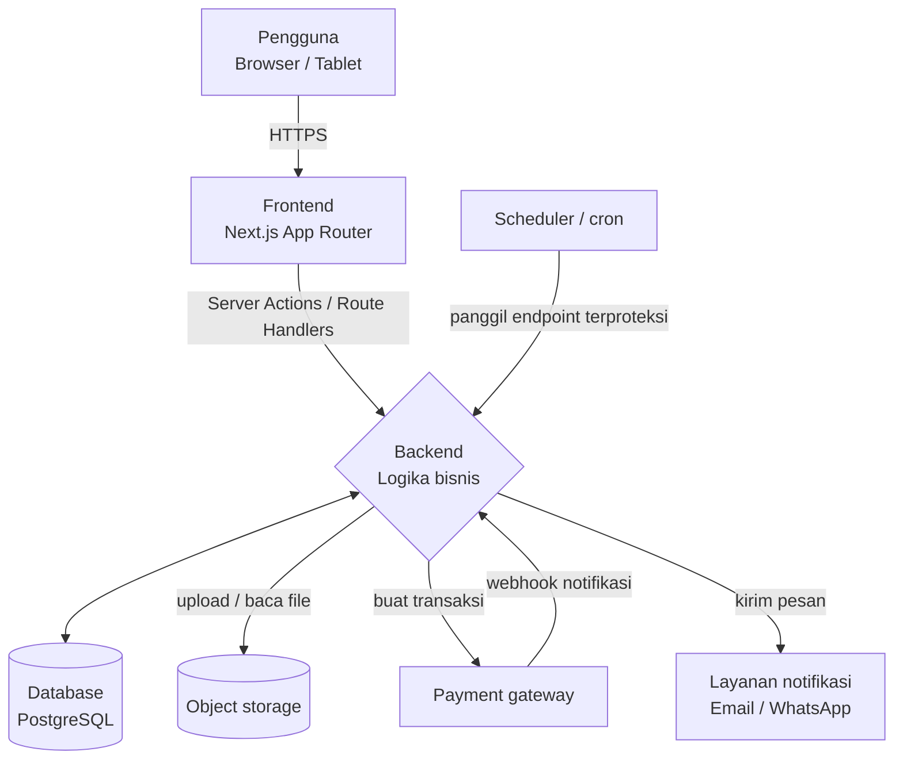
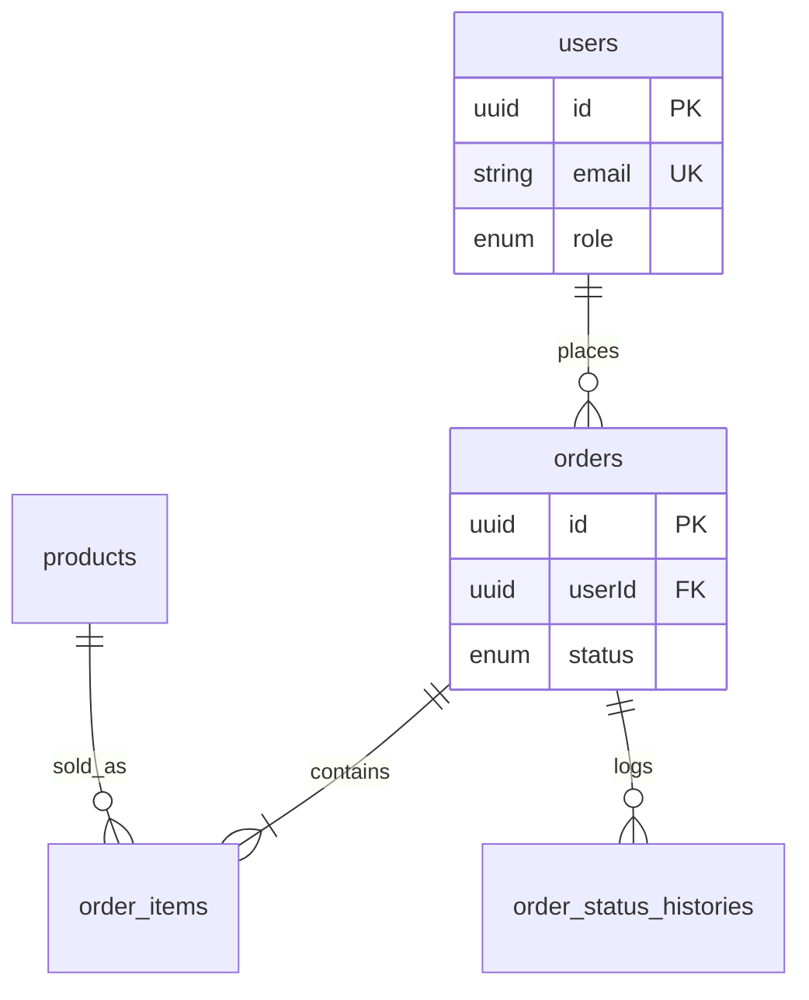
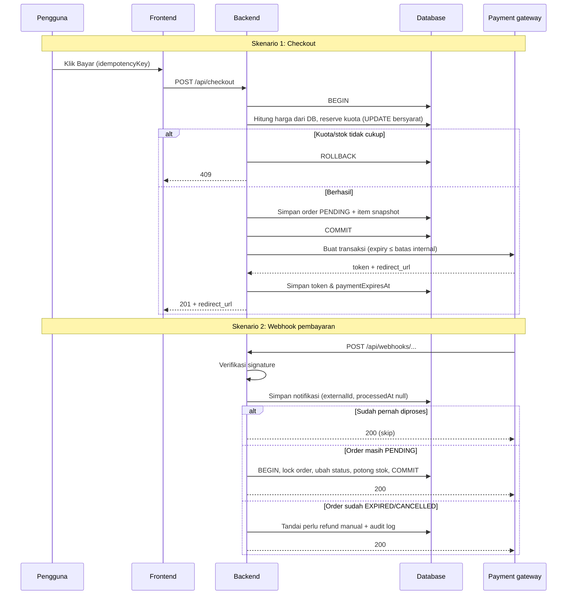

## 1. Ringkasan & tujuan
- **Nama produk:** [nama]
- **Satu kalimat:** [Aplikasi X membantu Y melakukan Z]
- **Masalah yang diselesaikan:** [2–3 kalimat]
- **Tujuan terukur:**
  - [mis. Proses approval cash advance < 1 hari]
  - [mis. Mendukung 50 user konkuren]
- **Status saat ini:** [greenfield di atas Starter Next JS / sudah ada kode di repo X]

## 2. Pengguna & peran
Setiap role harus punya daftar izin yang jelas; AI akan memakainya untuk middleware otorisasi.

| Role | Deskripsi | Boleh | Tidak boleh |
|---|---|---|---|
| [Admin] | [pengelola sistem] | [kelola user, semua data] | [-] |
| [Manager] | [approver] | [approve/reject request tim] | [hapus data] |
| [Staff] | [pengguna harian] | [buat & lihat request milik sendiri] | [lihat data user lain] |

## 3. Scope: in / out
**In scope (versi ini):**
- [fitur inti 1]
- [fitur inti 2]

**Out of scope (JANGAN dibuat):**
- [mis. aplikasi mobile native]
- [mis. integrasi payment gateway]
- [mis. multi-bahasa]

**Asumsi:** [mis. user sudah punya akun dari AD; tidak perlu registrasi publik]

## 4. Tech stack & konvensi
Salin stack persis dari AGENTS.md template Starter Next JS. Bagian ini mencegah AI mengganti library di tengah jalan. Isi kolom "Sudah dari template?" agar AI tahu mana yang tinggal dipakai dan mana yang perlu dibuat.

| Lapisan | Pilihan (dari AGENTS.md) | Sudah dari template? | Catatan |
|---|---|---|---|
| Frontend | [Next.js App Router, TypeScript] | [Ya] | [UI library, mis. Tailwind + shadcn/ui] |
| Backend | [Server Actions / Route Handlers] | [Ya] | [validasi input, mis. Zod] |
| ORM & database | [mis. Prisma/Drizzle + PostgreSQL lokal] | [Ya] | [cara migrasi & seed] |
| Auth | [bawaan template] | [Ya] | [cara buat akun pertama, role] |
| File storage | [lokal / S3-compatible] | [Ya/Tidak] | [batas ukuran file] |
| Email / notifikasi | [mis. SMTP / Resend] | [Ya/Tidak] | |
| Background job | [cron / queue] | [Ya/Tidak] | |
| Testing | [unit + E2E] | [Ya/Tidak] | |
| Deploy | [Docker / Vercel / VM] | [Ya/Tidak] | [env production] |

**Cek kecocokan dengan target deploy.** Pilihan deploy mengubah apa yang boleh dipakai di baris lain. Jawab untuk target yang dipilih:

| Pertanyaan | Jika serverless (Vercel, Netlify, dsb.) | Jika VM / Docker |
|---|---|---|
| File upload disimpan di mana? | Filesystem tidak persisten → wajib object storage (S3, R2, Vercel Blob) | Folder lokal boleh, dengan volume persisten |
| Database di mana? | Hosted (mis. Neon, Supabase, RDS), bukan "lokal" | Lokal/container boleh |
| Cron/job terjadwal | Tulis cara autentikasi persis yang dikirim platform dan batas frekuensinya per plan | Crontab/scheduler sendiri; header bebas |
| Proses yang lama (> beberapa detik) | Cek batas timeout fungsi | Bebas |

Tulis pilihannya di kolom Catatan tabel di atas. Jika dev dan production berbeda (lokal vs serverless), tulis keduanya.

### Diagram arsitektur
Wajib ada. Gambarkan semua komponen yang berjalan dan siapa memanggil siapa, termasuk setiap layanan pihak ketiga, cron, dan storage. Tulis dalam Mermaid flowchart supaya AI bisa membacanya sebagai teks.

**Aturan:**
- Setiap komponen di diagram muncul di tabel tech stack di atas, dan sebaliknya.
- Label panah menyebut apa yang dikirim (mis. "webhook notifikasi"), bukan hanya garis kosong.
- Panah dari pihak ketiga ke backend (webhook, callback) wajib digambar, karena itulah titik yang butuh verifikasi signature dan idempotensi.

**Konvensi kode:**
- Struktur folder: [src/app, src/lib, src/components, prisma/]
- Penamaan: [camelCase untuk variabel, PascalCase untuk komponen, snake_case untuk kolom DB]
- Bahasa UI: [Bahasa Indonesia]; bahasa kode & komentar: [Inggris]
- Format tanggal & mata uang: [DD/MM/YYYY, Rupiah tanpa desimal]

## 5. Model data
Definisikan entitas sebelum fitur. Ini fondasi yang paling sering membuat AI salah arah kalau dibiarkan kabur.

### Entitas: [Request]
| Field | Tipe | Wajib | Aturan |
|---|---|---|---|
| id | UUID | Ya | primary key |
| [title] | [string(150)] | [Ya] | |
| [amount] | [decimal(15,2)] | [Ya] | [> 0] |
| [status] | [enum] | [Ya] | [DRAFT, SUBMITTED, APPROVED, REJECTED] |
| [createdById] | [UUID → User] | [Ya] | |
| createdAt | timestamp | Ya | default now |

**Relasi:** [User 1—N Request; Request 1—N Attachment]

**Aturan bisnis:**
- **BR-01:** [Request hanya bisa diedit saat status DRAFT]
- **BR-02:** [Amount > Rp10.000.000 butuh approval 2 level]
- **BR-03:** [Data tidak dihapus permanen; gunakan soft delete deletedAt]

(Ulangi tabel untuk setiap entitas. Untuk sistem besar, tempel langsung schema.prisma atau DDL SQL di sini.)

**Wajib dijawab per entitas (jangan dikosongkan):**
- **Field turunan:** untuk setiap nilai yang muncul di API tapi tidak ada di tabel (mis. ratingAvg, total), tulis apakah dihitung saat query atau disimpan di kolom (dan kapan diperbarui).
- **Nomor berurutan:** untuk format seperti INV-YYYYMMDD-####, tulis mekanismenya (mis. tabel counter yang di-update dalam satu transaksi), bukan hanya formatnya.
- **Default yang jelas:** tulis satu nilai (default false), bukan kombinasi.
- Semua tabel yang disebut di bagian lain (mis. audit_logs di bagian 9) wajib punya tabel entitas di sini.

### Siklus hidup sumber daya
Untuk setiap sumber daya yang bisa habis atau dipakai (stok, kuota voucher, keranjang, slot, saldo), isi tabel ini. Inilah sumber bug paling umum kalau dibiarkan AI menebak.

| Sumber daya | Dicek saat | Dikurangi / dipakai saat | Dikembalikan saat | Jika gagal di tengah |
|---|---|---|---|---|
| [mis. Stok produk] | [checkout] | [webhook PAID, decrement atomik WHERE stock >= qty] | [order PAID di-cancel admin] | [stok tidak cukup saat PAID → order ditandai NEEDS_REVIEW, refund manual] |
| [mis. Kuota voucher] | [validasi di checkout] | [order PAID] | [order EXPIRED/CANCELLED sebelum PAID] | [kuota habis saat PAID → diskon tetap berlaku, catat di audit log] |
| [mis. Isi keranjang] | – | [dikosongkan saat order dibuat] | [–] | [order gagal dibuat → keranjang tetap utuh] |

Isi satu kolom "Dikembalikan saat" untuk setiap status akhir yang bisa dicapai sumber daya itu (dibatalkan, kedaluwarsa, ditolak, refund, retur). Status akhir yang tidak disebut = AI akan menebak apakah stok/kuota kembali.

**Kembalikan hanya yang benar-benar sudah dipakai.** Jika ada jalur di mana pemakaian bisa gagal atau dilewati (mis. stok kurang saat PAID sehingga tidak dipotong), simpan penanda di data transaksi (mis. stockDeducted boolean atau jumlah yang dipotong per item). Pengembalian membaca penanda ini, bukan menebak dari status, supaya stok/kuota tidak bertambah dari sesuatu yang tidak pernah dikurangi.

### Konkurensi & idempotensi
- **Operasi rebutan:** [daftar operasi yang bisa dijalankan dua user bersamaan pada data yang sama, dan cara mencegahnya: transaksi DB, decrement atomik, unique constraint, row lock]
- **Operasi yang bisa terpanggil ulang:** [webhook, tombol submit, cron] — tulis cara membuatnya idempotent sesuai aturan di bawah (guard status sebelum mengubah + kunci idempotensi + penanda sudah diproses).

**Aturan idempotensi yang wajib diikuti:**
- **Kunci idempotensi dari client:** unique penuh dan di-scope per user, mis. (userId, idempotencyKey). Jangan unique parsial berdasarkan kolom yang berubah (mis. WHERE status = 'PENDING'), karena begitu status berubah, kunci yang sama bisa membuat data ganda.
- **Deduplikasi webhook:** catat kapan sebuah event selesai diproses (mis. processedAt). Event duplikat yang sudah diproses → skip + 200; yang belum berhasil diproses (error sebelumnya) → proses ulang. Unique constraint saja tidak cukup, karena memblokir retry yang memang dibutuhkan.

**Balapan antara timer internal dan event eksternal.** Jika ada batas waktu internal (expiry order, hold slot, reservasi) dan event dari luar (pembayaran, konfirmasi) bisa datang di detik yang sama, tulis:
- Batas waktu di sisi penyedia diset sama atau lebih pendek dari batas internal (mis. parameter expiry di payment gateway): [isi untuk produk ini]
- Batas yang ditampilkan ke user adalah batas penyedia (yang lebih pendek), bukan batas internal. Simpan keduanya terpisah (mis. paymentExpiresAt dari penyedia dan expiresAt internal). Setelah batas penyedia lewat, tombol "bayar" disembunyikan walau status internal belum berubah: [isi untuk produk ini]
- Pembatalan internal juga dibatalkan di penyedia. Jika user/admin membatalkan sebelum batas waktu, panggil API pembatalan/expire milik penyedia supaya pembayaran tidak bisa masuk lagi. Jika penyedia tidak punya API itu, tulis bahwa pembayaran telat akan masuk jalur di bawah: [isi untuk produk ini]
- Apa yang terjadi jika event sukses datang untuk data yang sudah kedaluwarsa/dibatalkan (mis. catat + tandai "perlu refund manual" + audit log). Jangan dibiarkan ditolak diam-diam: [isi untuk produk ini]

### Tabel bawaan template
Template Starter Next JS sudah punya tabel auth (user, session, account, dsb.). Tulis aturannya secara eksplisit:
- **Extend, jangan duplikasi:** field tambahan user (mis. role, phone, referralCode) ditambahkan ke tabel user milik template. Jangan membuat tabel users kedua.
- Password & session mengikuti tabel template; jangan definisikan ulang passwordHash di PRD.
- Tulis nama tabel user template yang dipakai: [salin dari schema template setelah setup].

### Tabel pendukung yang sering terlupa
Cek daftar ini. Jika fiturnya ada di PRD, tabelnya wajib ada di bagian 5.

| Jika PRD punya... | Wajib ada tabel | Field minimal |
|---|---|---|
| Timeline / riwayat status (mis. pesanan, tiket, approval) | `<entitas>_status_histories` | id, entitasId, fromStatus, toStatus, changedById, note, createdAt |
| Webhook / notifikasi pihak ketiga (payment, kurir) | `<provider>_notifications` | id, externalId (ID mentah dari payload, mis. order_id penyedia), entitasId nullable (null jika ID tidak dikenal / payload palsu), eventType/status, signatureValid, rawPayload JSONB, receivedAt, processedAt, processError |
| Voucher / kupon / kuota per user | `<voucher>_redemptions` | id, voucherId, userId, orderId, status (RESERVED/USED/RELEASED); unique (orderId); batas per user dicek di transaksi (lihat aturan constraint), unique (voucherId, userId) parsial WHERE status <> 'RELEASED' hanya jika batasnya pasti 1 |
| Nomor dokumen berurutan (INV-, PO-, TKT-) | `<dokumen>_counters` | key/period (PK), lastSeq; di-increment dalam transaksi yang sama |
| Token / sesi dari pihak ketiga yang perlu dipakai ulang | kolom di tabel transaksi | mis. paymentToken, paymentRedirectUrl, paymentExpiresAt (batas penyedia) |
| Flag yang butuh tindak lanjut manusia (perlu refund, perlu review, perlu verifikasi) | kolom di tabel terkait | flag + resolvedAt, resolvedById, resolutionNote; daftar "perlu tindakan" = flag true dan resolvedAt null |
| Audit log | `audit_logs` | id, userId, action, entity, entityId, meta JSONB, createdAt |
| Data yang bisa berubah tapi harus tercatat apa adanya (harga, alamat, nama produk) | kolom snapshot di tabel transaksi | mis. productName, unitPrice di item order |

### Aturan constraint
- **Unique + soft delete:** tulis apakah nilai unik (slug, kode, email) boleh dipakai ulang setelah data dihapus. Jika boleh, pakai partial unique index `WHERE deletedAt IS NULL`.
- **Unique pada foreign key = relasi satu-ke-satu.** Sebelum memberi unique pada kolom FK (mis. voucherId di tabel pesanan), cek: apakah satu baris di tabel induk memang hanya boleh dipakai sekali seumur hidup? Jika tidak, taruh unique di tabel penghubung (mis. orderId di tabel redemption), bukan di FK.
- **Partial unique hanya pada kolom yang stabil.** Kondisi WHERE boleh memakai deletedAt atau status yang memang berarti "tidak aktif lagi"; jangan memakai status alur kerja yang berpindah terus.
- **Batas yang bisa diatur tidak boleh dikunci constraint.** Jika ada kolom limit yang bisa diubah (mis. perUserLimit, maxPerOrder), jangan pakai unique constraint yang diam-diam memaksanya selalu 1. Cek limit dengan hitungan di dalam transaksi (mis. COUNT(*) WHERE status <> 'RELEASED' dengan row lock). Unique hanya dipakai jika batasnya memang tetap 1.
- **Data "milik user" wajib punya kolom pemilik.** Jika fitur menyebut sesuatu personal/milik user (voucher personal, alamat tersimpan, file user), entitasnya wajib punya kolom pemilik (mis. userId nullable: null = publik) dan endpoint /me/... memfilter dari kolom itu.
- Diskon persen wajib punya batas maksimum (maxDiscount), dan diskon apa pun tidak boleh membuat total negatif.
- Uang disimpan integer (satuan terkecil mata uang), tidak pakai float.
- **Index:** tulis index untuk setiap kolom yang dipakai filter, sort, atau join di bagian 7.

### Diagram ERD
Wajib ada. Tulis dalam Mermaid supaya AI bisa membaca relasinya langsung; banyak editor dan GitHub juga merendernya jadi gambar.

Setiap tabel di diagram harus punya tabel entitas di atas, dan sebaliknya.

## 6. Fitur & user story dengan acceptance criteria
Satu fitur = satu blok dengan format yang sama. AI bekerja paling baik saat bisa mengubah acceptance criteria langsung jadi tes.

### F-01: [Nama fitur, mis. Membuat request]
- **Prioritas:** [Must / Should / Could]
- **User story:** Sebagai [Staff], saya ingin [membuat request cash advance] agar [dana bisa diproses].
- **Alur:**
  1. User membuka [/requests/new]
  2. [Mengisi form: title, amount, lampiran (opsional)]
  3. [Klik "Simpan draft" atau "Submit"]
- **Acceptance criteria:**
  - [ ] Given [form valid], when [klik Submit], then [request tersimpan dengan status SUBMITTED dan user diarahkan ke halaman detail]
  - [ ] Given [amount ≤ 0], when [submit], then [muncul error "Nominal harus lebih dari 0" dan data tidak tersimpan]
  - [ ] Given [user bukan Staff], when [akses /requests/new], then [dapat 403]
- **Edge case:** [lampiran > 5 MB ditolak; double-click submit tidak membuat data ganda]
- **Bergantung pada:** [F-00 Login]
- **Efek samping:** [apa lagi yang berubah selain data utama: stok, kuota, keranjang dikosongkan, email terkirim, audit log]
- **Input lengkap:** [setiap field yang dipakai fitur ini, termasuk dari fitur lain (mis. voucherCode di checkout); semuanya ada di request bagian 7]
- **Nilai yang dihitung server:** [harga, subtotal, diskon, total, dan role tidak pernah diterima dari client; tulis "dihitung server dari ..."]
- **Status yang boleh:** [jika fitur mengubah status, rujuk aturan transisi BR-xx]
- **Fitur bertahap:** [jika sebagian fitur baru dikerjakan di milestone berikutnya, tulis bagian mana di milestone mana dan perilakunya sebelum aktif (mis. parameter belum didukung → 400 atau fallback); tulis "–" jika tidak ada]
- **Potensi penyalahgunaan:** [untuk fitur yang memberi nilai (voucher, reward, poin, kredit, trial), tulis pemicunya dan batasnya. Pemicu sebaiknya aksi yang sulit dipalsukan (mis. pembayaran pertama lunas), bukan aksi gratis (mis. registrasi); jika dipicu aksi gratis, tulis batasnya (per user, per hari, total). Tulis "–" jika fitur tidak memberi nilai]
- **Konsistensi AC dengan API:** [kode status dan perilaku di acceptance criteria sama persis dengan tabel bagian 7 (mis. AC bilang toggle tanpa error, API jangan mengembalikan 409)]

(Ulangi struktur yang sama untuk setiap fitur F-02, F-03, ...)

### Sequence diagram alur kritis
Wajib untuk setiap alur yang melibatkan uang, stok/kuota, pihak ketiga, atau lebih dari satu tabel dalam satu transaksi (mis. checkout, webhook pembayaran, pembatalan, cron expiry). Alur CRUD biasa tidak perlu.

**Aturan:**
- Deklarasikan semua participant di awal; jangan memakai nama yang tidak dideklarasikan (diagram gagal dirender).
- Tulis batas transaksi DB (BEGIN / COMMIT / ROLLBACK) dan urutan pemanggilan pihak ketiga terhadap commit (sebelum atau sesudah). Ini menentukan apa yang terjadi jika pihak ketiga gagal.
- Setiap cabang gagal yang ada di acceptance criteria digambar sebagai blok alt / else, dengan kode status yang sama dengan tabel API bagian 7.
- Jika pihak ketiga gagal setelah commit (mis. pembuatan token pembayaran error), tulis apa yang terjadi pada data yang sudah tersimpan.

## 7. API / kontrak
Kontrak yang tertulis membuat frontend dan backend yang dibuat AI di sesi berbeda tetap cocok.

| Method | Endpoint | Role | Request | Response sukses | Error |
|---|---|---|---|---|---|
| [POST] | [/api/requests] | [Staff] | [{title, amount}] | [201 {id, status}] | [400 validasi, 403] |
| [GET] | [/api/requests?status=] | [semua] | [query] | [200 {data[], total}] | [401] |
| [PATCH] | [/api/requests/:id/approve] | [Manager] | [{note?}] | [200 {status}] | [409 status tidak valid] |

**Format error standar:** `{ "error": { "code": "VALIDATION_ERROR", "message": "...", "fields": {} } }`

**Route bawaan template:** tandai endpoint yang sudah disediakan template (mis. auth) dengan "(template)" dan tulis "ikuti route template, jangan buat ulang".

**Kelengkapan endpoint:**
- Setiap endpoint adalah satu baris di tabel API di atas, termasuk health check, upload, export, cron, dan webhook. Jangan menyebut endpoint hanya di bullet, catatan, atau bagian lain; AI membaca tabel sebagai daftar lengkap.
- Setiap entitas yang dikelola admin punya endpoint list/create/update/delete (atau ditulis eksplisit "dikelola lewat seed saja").
- Data master yang dipakai sebagai filter publik (mis. kategori) punya endpoint baca publik.
- Setiap aksi yang disebut di fitur atau tech stack (upload file, export, cron) muncul sebagai baris di tabel ini.
- Setiap kolom yang dikembalikan ke client (token pembayaran, URL redirect) disimpan di tabel bagian 5 jika perlu diambil lagi nanti.
- Setiap flag tindak lanjut (mis. perlu refund) punya endpoint untuk menandai selesai, yang mengisi kolom penyelesaiannya.

### Integrasi eksternal
AI sering mengarang endpoint pihak ketiga. Isi blok ini per integrasi, dengan nilai yang disalin dari dokumentasi resmi, bukan dari ingatan.

**Integrasi: [nama, mis. Midtrans Snap]**

| Item | Isi |
|---|---|
| Dokumentasi resmi | [link halaman docs yang dipakai] |
| Endpoint sandbox | [URL persis, mis. POST https://app.sandbox.midtrans.com/snap/v1/transactions] |
| Endpoint produksi | [URL persis] |
| Autentikasi | [format persis, mis. Basic auth = base64(SERVER_KEY:)] |
| Contoh request | [payload minimal] |
| Contoh response | [field yang dipakai, mis. token, redirect_url] |
| Batas waktu di sisi penyedia | [parameter expiry yang dikirim; harus ≤ batas internal di bagian 5] |
| Pemanggilan ulang | [apakah ID transaksi yang sama boleh dikirim lagi? Jika tidak, token/URL pertama disimpan dan dipakai ulang] |
| Redirect setelah selesai | [URL tujuan user setelah sukses/gagal/batal] |
| Env var | [nama variabel] |

**Webhook / notifikasi (jika ada):**
- **Verifikasi:** [rumus signature persis + field yang dibandingkan, termasuk format angka, mis. gross_amount berupa string "210000.00"]
- **Mapping SEMUA status** dari dokumentasi ke status internal, termasuk yang jarang (mis. capture + fraud_status, refund, partial_refund). Aturan mapping:
  - Petakan ke status internal yang artinya sama (mis. expire → EXPIRED, bukan CANCELLED). Jika tidak ada padanannya, tambahkan status internal atau tulis alasannya.
  - Untuk setiap status, tulis apakah dana benar-benar sudah ditarik, baru ditahan/pending (mis. authorize pada pre-auth kartu ≠ lunas), atau sudah dikembalikan oleh penyedia (refund). Refund dari penyedia dicatat sebagai "sudah dikembalikan", bukan "perlu refund manual".
  - Status yang tidak dikenal → log + 200, jangan ubah data.
- **Event untuk data yang sudah final:** [apa yang terjadi jika notifikasi sukses datang untuk data yang sudah kedaluwarsa/dibatalkan (lihat "Balapan antara timer internal dan event eksternal" di bagian 5)]
- **Idempotensi:** [event yang sama datang dua kali tidak mengulang efek samping, tapi event yang sebelumnya gagal diproses tetap bisa diproses ulang (lihat aturan idempotensi di bagian 5)]
- **ID dari penyedia:** [field mana yang dikirim penyedia sebagai ID (mis. order_id = orderNumber kita, bukan UUID) dan cara mencocokkannya]
- **Testing lokal:** webhook butuh URL publik. Tulis caranya: [mis. cloudflared tunnel / ngrok http 3000, lalu set Notification URL di dashboard penyedia].

(Ulangi blok untuk setiap integrasi.)

## 8. UI / halaman
| Route | Halaman | Role | Komponen utama |
|---|---|---|---|
| [/login] | [Login] | [publik] | [form username/password] |
| [/dashboard] | [Dashboard] | [semua] | [kartu ringkasan, tabel request terbaru] |
| [/requests] | [Daftar request] | [semua] | [tabel + filter status + pagination 20/hal] |
| [/requests/:id] | [Detail] | [pemilik, Manager] | [info, timeline status, tombol aksi] |

**Panduan visual:** [layout sidebar kiri; warna primer #...; tampilan responsif minimal 375px]

**Referensi:** [lampirkan screenshot, wireframe, atau link Figma; AI bisa membaca gambar]

**State yang wajib ada:** loading, kosong (empty state), error, sukses (toast).

**Kelengkapan halaman:** setiap route yang disebut di fitur (bagian 6) ada di tabel ini, dan setiap entitas yang punya endpoint admin di bagian 7 punya halaman kelolanya (atau ditulis "dikelola lewat seed saja").

## 9. Non-functional & keamanan
- **Performa:** [halaman < 2 detik; query list pakai pagination & index]
- **Keamanan:**
  - Validasi semua input di server (Zod), bukan hanya di client
  - Otorisasi dicek di setiap endpoint, bukan hanya disembunyikan di UI
  - Password di-hash (bcrypt/argon2); secret hanya di .env, tidak di-commit
  - Proteksi CSRF, rate limit login, header keamanan
- **Audit log:** [catat siapa, kapan, aksi apa untuk create/update/approve]
- **Kepatuhan:** [mis. retensi data 5 tahun; data pribadi sesuai UU PDP]
- **Observability:** [log terstruktur JSON; health check /api/health]

## 10. Rencana milestone bertahap
Setiap milestone harus bisa dijalankan dan dites sendiri sebelum lanjut. Jangan lanjut kalau milestone sebelumnya belum lolos.

1. **M0 — Fondasi:** jalankan prompt di bagian 0 (Starter Next JS), lalu tambahkan schema entitas dari bagian 5 + seed data. Selesai jika: dev server merespons, akun pertama bisa dibuat, dan migrasi baru sukses.
2. **M1 — Auth & role:** sesuaikan auth bawaan template dengan role di bagian 2 (F-00). Selesai jika: tiap role hanya bisa akses halamannya.
3. **M2 — Fitur inti:** [F-01, F-02]. Selesai jika: semua acceptance criteria lolos tes.
4. **M3 — Fitur pendukung:** [laporan, export, notifikasi].
5. **M4 — Hardening:** audit log, error handling, tes E2E, dokumentasi deploy.

## 11. Aturan untuk AI agent
Salin bagian ini ke `CLAUDE.md` (Claude Code), `AGENTS.md`, atau `.cursorrules` supaya dibaca di setiap sesi.

- Baca `docs/PRD.md` sebelum mulai. Kerjakan hanya milestone/fitur yang diminta.
- Jika ada yang ambigu atau bertentangan, tanya dulu, jangan berasumsi.
- Jangan menambah library baru tanpa izin. Jangan mengubah tech stack.
- Jangan menghapus atau menulis ulang kode yang tidak terkait tugas, termasuk fitur bawaan template.
- Untuk integrasi pihak ketiga, pakai endpoint dan format dari bagian 7. Jika tampak berbeda dari dokumentasi resmi, berhenti dan tanya.
- Harga, total, diskon, dan role selalu dihitung/dicek di server; jangan percaya nilai dari client.
- Operasi pada stok, kuota, atau saldo wajib atomik (transaksi DB atau update bersyarat), sesuai tabel siklus hidup di bagian 5.
- Tulis tes untuk setiap acceptance criteria; jalankan tes dan lint sebelum menyatakan selesai.
- Setelah selesai, laporkan: file yang diubah, cara verifikasi, dan hal yang belum dikerjakan.
- Perbarui `docs/PROGRESS.md` (checklist fitur + catatan keputusan) di akhir setiap sesi.
- Commit kecil per fitur dengan ID fitur di pesannya, mis. `feat(F-02): katalog dengan filter kategori`.

**Perintah penting:**
- Dev: [salin dari AGENTS.md]
- Tes: [salin dari AGENTS.md]
- Lint: [salin dari AGENTS.md]
- Migrasi: [salin dari AGENTS.md]

Ganti semua [...] dengan perintah asli sebelum dipakai; perintah yang salah membuat agent gagal verifikasi.

## 12. Checklist sebelum PRD diberikan ke AI
Centang semua. Satu yang belum = AI akan menebak di bagian itu.

- [ ] Tidak ada placeholder [...] atau typo nilai default yang tersisa
- [ ] Pilihan file storage, database, dan cron cocok dengan target deploy (tabel cek deploy di bagian 4)
- [ ] Setiap tabel yang disebut di bagian mana pun punya entitas di bagian 5 dan muncul di ERD Mermaid
- [ ] Tabel user template di-extend, bukan diduplikasi
- [ ] Tabel pendukung (riwayat status, notifikasi webhook, redemption, counter, audit log) ada untuk setiap fitur yang membutuhkannya
- [ ] Tabel notifikasi webhook menyimpan ID mentah penyedia dan FK-nya nullable
- [ ] Setiap field di response API ada di tabel atau dijelaskan sebagai field turunan
- [ ] Tabel siklus hidup terisi untuk semua stok/kuota/saldo/keranjang, termasuk status refund/retur
- [ ] Pengembalian stok/kuota memakai penanda "sudah dipakai", bukan ditebak dari status
- [ ] Tidak ada unique pada FK yang tidak sengaja membuat relasi satu-ke-satu; partial unique hanya pada kolom stabil
- [ ] Tidak ada limit yang bisa diatur (perUserLimit dsb.) yang dikunci unique constraint
- [ ] Setiap data "milik user"/personal punya kolom pemilik
- [ ] Setiap flag tindak lanjut punya kolom penyelesaian (resolvedAt, resolvedById) dan endpoint untuk menandai selesai
- [ ] Kunci idempotensi unique penuh per user; webhook gagal tetap bisa diproses ulang
- [ ] Balapan timer internal vs event eksternal sudah ditulis: expiry di penyedia ≤ expiry internal, batas yang ditampilkan ke user = batas penyedia, pembatalan internal ikut dibatalkan di penyedia, dan penanganan event telat
- [ ] Aturan unique + soft delete dan batas diskon sudah ditulis
- [ ] Setiap endpoint ada sebagai baris tabel API bagian 7 (termasuk health, upload, cron, webhook), setiap field yang dipakai fitur ada di request-nya, dan setiap entitas admin punya endpoint lengkap
- [ ] Kode status di acceptance criteria sama dengan tabel API
- [ ] Fitur pemberi nilai (voucher, reward, poin) punya pemicu yang sulit dipalsukan atau batas yang jelas
- [ ] Tidak ada endpoint yang menerima harga, subtotal, total, atau role dari client
- [ ] Endpoint & auth integrasi pihak ketiga disalin dari dokumentasi resmi + link-nya dicantumkan
- [ ] Mapping status webhook mencakup semua status dari dokumentasi, memetakan ke status internal yang artinya sama, dan menandai dana ditarik/ditahan/dikembalikan
- [ ] Cara testing webhook di lokal (tunnel) tertulis di milestone yang membutuhkannya
- [ ] Route bawaan template ditandai, tidak dispesifikasikan ulang
- [ ] Perintah penting di bagian 11 sudah diisi dari AGENTS.md
- [ ] Bagian 0 (berisi token) benar-benar sudah tidak ada di file yang masuk repo (cek isi file-nya, bukan hanya asumsi)
- [ ] Diagram arsitektur memuat semua komponen di tech stack, termasuk panah webhook/callback dari pihak ketiga
- [ ] Setiap alur yang melibatkan uang, stok/kuota, pihak ketiga, atau multi-tabel punya sequence diagram dengan batas transaksi dan cabang gagal yang sama dengan acceptance criteria
- [ ] Semua diagram Mermaid valid (participant dideklarasikan, bisa dirender)
